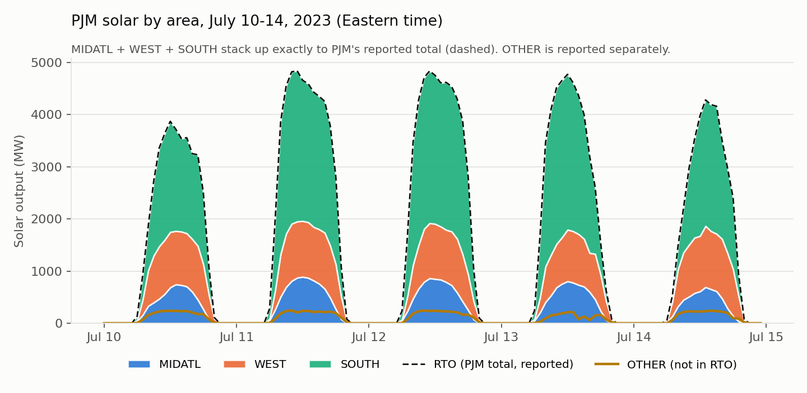
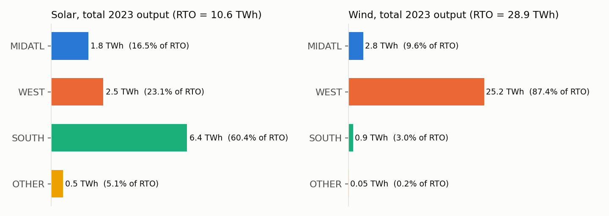

# Questions for Yifan

*Updated October 23, 2026*

## Still open

1. **Grid test system.** You said the model should cover the Eastern Interconnection. Which specific test case should we use? The best-known public option is Texas A&M's synthetic **ACTIVSg70k** (about 70,000 buses on the Eastern Interconnection footprint, with bus locations), from the [Electric Grid Test Case Repository](https://electricgrids.engr.tamu.edu/). Is that the one, or does the group have its own files? We need the bus and line data to split area data down to buses.

2. **Year.** Which year should the data cover? We are using 2023 for now.

3. **PJM "OTHER" area.** PJM reports solar and wind for six areas. Three of them (MIDATL, WEST, SOUTH) add up exactly to PJM's total (RTO), so those are what we use. A fourth area, "OTHER", is *not* part of PJM's total. In 2023 it had about 5% as much solar as all of PJM, and almost no wind (0.2%). It is probably generation outside PJM's footprint that PJM still tracks, but we don't know for sure. Should we include it, and if so, which buses does it belong to?

   

   

   Source: PJM Data Miner 2, [Solar Generation by Area](https://dataminer2.pjm.com/feed/solar_gen) and [Wind Generation by Area](https://dataminer2.pjm.com/feed/wind_gen), hourly, 2023. The sixth area, RFC, is MIDATL + WEST.

4. **Rooftop solar.** EIA-860, which we use to place solar capacity at buses, only lists plants of 1 MW or more, so most rooftop solar is missing. Is that acceptable, or should we account for it?

5. **File layout.** Does the file layout in Section 4 of the notebook (`areas.csv`, `demand.csv`, `solar.csv`, `wind.csv`, then bus-level files) work for the model?

## Data used so far

| Data | Source | Link |
|---|---|---|
| Hourly demand, MISO subregions | EIA-930 (EIA Open Data API) | [EIA API browser](https://www.eia.gov/opendata/browser/electricity/rto/region-sub-ba-data) |
| Hourly solar by PJM area | PJM Data Miner 2 | [solar_gen](https://dataminer2.pjm.com/feed/solar_gen) |
| Hourly wind by PJM area | PJM Data Miner 2 | [wind_gen](https://dataminer2.pjm.com/feed/wind_gen) |
| Plant locations and capacity (for bus weights) | EIA-860 | [EIA-860](https://www.eia.gov/electricity/data/eia860/) |

The downloaded 2023 files are in `data/raw/` (`eia930_miso_subregion_demand_2023.csv`, `pjm_solar_2023.csv`, `pjm_wind_2023.csv`). Every file has the same three columns: `time_utc`, `area_id`, `value_mw`.

## Answered

- **Option A or Option B?** Start with Option A (split measured zone totals by installed capacity) and add on later. *(October 23, 2026)*
